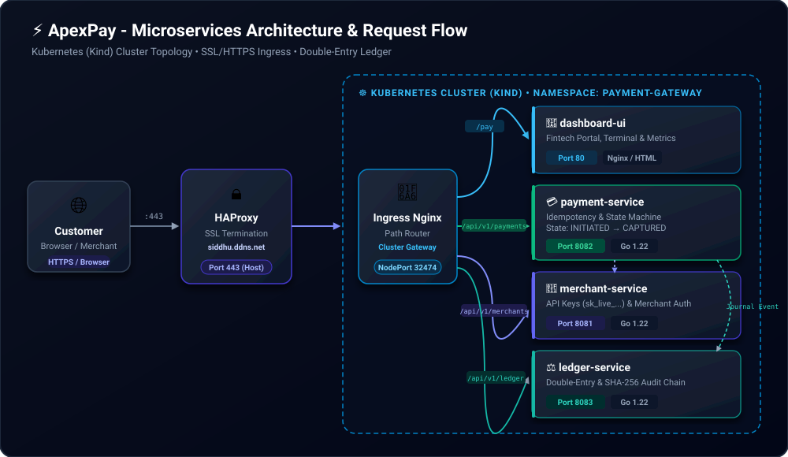
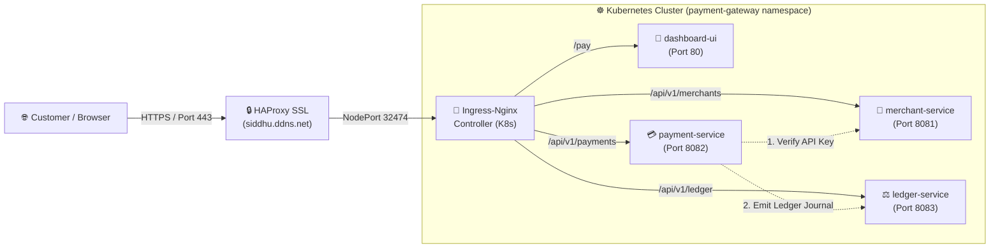

# ⚡ ApexPay - Microservices Payment Gateway

An enterprise-grade, high-speed **Payment Gateway** built with **Go (Golang)**, **Kubernetes**, and **Docker**. 

Just like real-world fintech systems (like **Stripe** or **PayPal**), ApexPay handles credit card authorizations, prevents double-charging, and maintains an immutable, double-entry financial ledger for accounting.

---

## 🌟 What is this project in simple words?

Imagine you own an online store:
1. When a customer pays, money doesn't just "magically" move—a **Payment Service** checks if the card is valid and makes sure the customer isn't accidentally charged twice if they click the button repeatedly.
2. The **Merchant Service** manages your business account and provides you with secret API keys.
3. The **Ledger Service** acts as a strict digital accountant: it records the exact payout to you, takes the platform processing fee, and locks the record with cryptographic math so nobody can alter financial history.
4. The **Web Dashboard** is a website where you can see all your money, test transactions, and issue customer refunds with a single click.

---

## 🧩 The 4 Microservices Explained Simply

| Microservice | Role | Port | Real-World Analogy |
| :--- | :--- | :--- | :--- |
| 🔑 **`merchant-service`** | **Identity & Keys** | `8081` | The account manager who creates your account and hands you your API keys. |
| 💳 **`payment-service`** | **Payment Engine** | `8082` | The card terminal that talks to Visa/Mastercard, captures money, and prevents duplicate charges. |
| ⚖️ **`ledger-service`** | **Financial Accountant** | `8083` | The immutable bookkeeping journal where every debit equals a credit ($\sum \text{Debits} = \sum \text{Credits}$). |
| 🎨 **`dashboard`** | **Web Interface** | `80` (External) | The merchant portal website where you interact with everything visually. |

---

## 🏛️ System Architecture Diagram





---

## 🚀 How to Access Your App (Right Now)

Your entire system is running 24/7 on your Kubernetes cluster and exposed via HTTPS.

### 🌐 Open in Any Web Browser:
```text
https://siddhu.ddns.net/pay
```

> [!NOTE]
> If your network requires direct port forwarding, you can also run:
> ```powershell
> ssh -i .\Downloads\admin_key.pem -L 8080:localhost:8080 ubuntu@15.207.89.114
> ```
> And open: **`http://localhost:8080`**

---

## 💳 How to Test the Payment Gateway (Step-by-Step)

Once you open **`https://siddhu.ddns.net/pay`**:

### 1. Make a Successful Payment
1. On the left side **Virtual Payment Terminal**, enter an amount (e.g., `$75.00`).
2. Keep the card set to **Visa ending 4242 (Instant Capture - Success)**.
3. Click the purple **"⚡ Authorize & Charge"** button.
4. **What happens:** You will immediately see a green `CAPTURED` badge, and the transaction will appear in the ledger table on the right.

---

### 2. Test Double-Charge Prevention (Idempotency)
*What happens if a user's internet lags and they click "Pay" 5 times?*
1. Immediately after step 1, **do NOT change the Idempotency Key**.
2. Click **"⚡ Authorize & Charge"** again.
3. **What happens:** You will see `CAPTURED (Cache: HIT)`. The system recognizes the transaction key, returns the original receipt, and **guarantees the customer was NOT charged twice**.

---

### 3. Test a Declined Card
1. Click **🎲 New Key** to start a fresh transaction.
2. Under "Select Test Payment Method", choose **Card ending 0000 (Simulated Decline)**.
3. Click **"⚡ Authorize & Charge"**.
4. **What happens:** You will see a red `DECLINED` badge with the reason: `card_declined_insufficient_funds`. Zero money is deducted.

---

### 4. Issue a Refund
1. Look at the **Transaction Ledger** table on the top right.
2. Find any successful `CAPTURED` transaction and click the red **"Refund"** link.
3. **What happens:** The status changes to `REFUNDED`. The **Double-Entry Ledger** automatically calculates the refund reversal and restores your balance.

---

## 🛠️ Handy Server Commands (Cheat Sheet)

All commands can be run via SSH on your server (`ubuntu@15.207.89.114`):

### 1. Check if all microservices are running:
```bash
kubectl get pods -n payment-gateway
```
*Expected: All 4 pods should show `1/1 Running`.*

### 2. View live logs of any microservice:
```bash
# View live payment logs
kubectl logs -n payment-gateway deployment/payment-service -f

# View live ledger logs
kubectl logs -n payment-gateway deployment/ledger-service -f
```

### 3. Run the automated test suite:
```bash
cd /home/ubuntu/payment-gateway
./test-k8s.sh
```

### 4. Restart all services if needed:
```bash
kubectl rollout restart deployment -n payment-gateway
```

---

## 📁 Where is the Source Code?

* **On the Remote Server:** `/home/ubuntu/payment-gateway/`
* **On Your Local Windows Machine:** `C:\Users\saisiddartha.p\.gemini\antigravity\brain\...\scratch\payment-gateway\`

```text
payment-gateway/
├── services/
│   ├── merchant-service/    # Go source code for merchants & keys
│   ├── payment-service/     # Go source code for payments & idempotency
│   ├── ledger-service/      # Go source code for double-entry bookkeeping
│   └── dashboard/           # HTML, CSS & Nginx web dashboard
├── k8s/                     # Kubernetes Deployment & Ingress manifests
├── docker-compose.yml       # Standalone Docker configuration
├── test-k8s.sh              # Automated Kubernetes test script
└── README.md                # This beginner guide
```

---

## 🔒 Security & Fintech Best Practices Included

* **ACID Transactions:** Financial records are strictly consistent.
* **Idempotency Keys:** Every payment request has a unique identifier to block duplicate charges.
* **SHA-256 Tamper-Evident Ledger:** Every journal entry contains a cryptographic hash of the previous entry, creating an unalterable audit chain.
* **Micro-footprint:** Built in compiled Go—each microservice uses less than **2 MB of RAM**!
